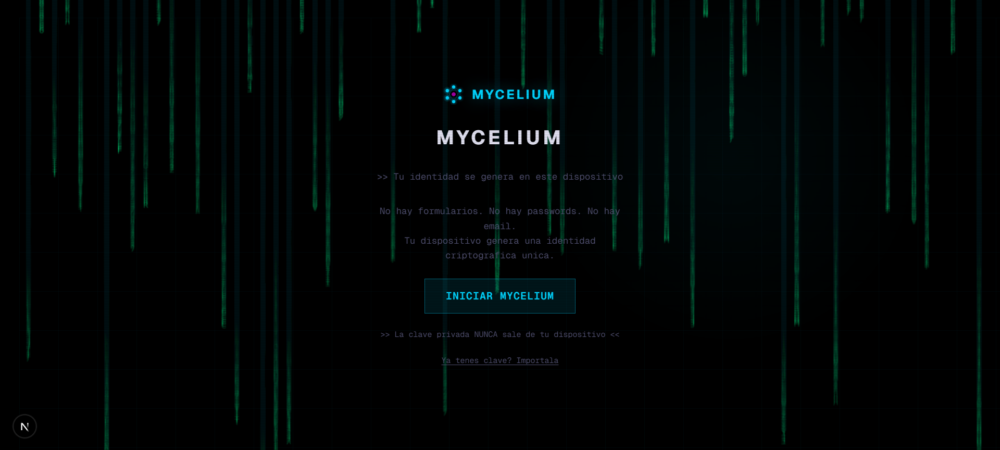
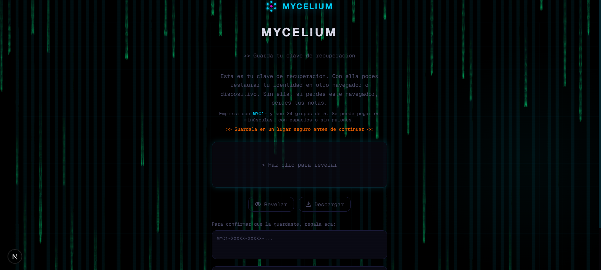
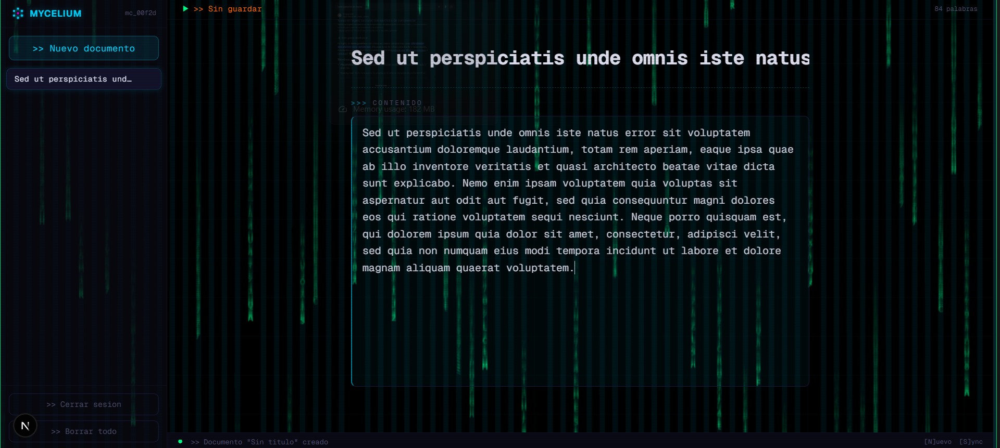

# 🍄 MYCELIUM — Local-First Knowledge Web

<p align="center">
  
</p>

<p align="center">
  <a href="https://nextjs.org/"></a>
  <a href="https://react.dev/"></a>
  <a href="https://www.typescriptlang.org/"></a>
  <a href="https://tailwindcss.com/"></a>
  <a href="https://yjs.dev/"></a>
  <a href="https://developer.mozilla.org/en-US/docs/Web/API/Web_Crypto_API"></a>
  
  
</p>

<p align="center">
  <b>A note editor that lives on your device.</b><br/>
  No accounts. No emails. No servers. No passwords. Your identity is a keypair generated by your browser.
</p>

---

## 🌐 Live Application

[](https://mycelium-wheat.vercel.app)

**Live demo:** https://mycelium-wheat.vercel.app

---

## ✨ Why MYCELIUM

- **Local-first by design.** Notes, identity and document list never leave your device.
- **Cryptographic identity, zero passwords.** An Ed25519 keypair is generated in-browser with the Web Crypto API.
- **Auto-titled notes.** The title is derived from the first non-empty line while you haven't set one by hand.
- **Recovery key.** Export a key, import it later — same identity, same notes.
- **Works offline.** No internet, no backend, no environment variables.
- **Cyberpunk UI.** Cyan / magenta / matrix green, scanlines, matrix rain, cursor glow.

---

## 📸 Screenshots

| Landing / identity | Recovery key |
|:------------------:|:------------:|
|  |  |

| Editor |
|:------:|
|  |

### What each screen shows

| Image | Description |
|-------|-------------|
| **landing.png** | Entry screen: identity is generated on this device, no forms, no passwords. "Start MYCELIUM" and "Import key" actions. |
| **recovery-key.png** | Recovery key reveal flow: 24 groups, copy/download, paste-back verification gate before continuing. |
| **editor.png** | Editor view: sidebar with documents, "New document", auto-derived title, markdown-friendly textarea, unsaved indicator. |

---

## 🎯 Features

### 📝 Notes
- Create, edit, rename (double-click in sidebar) and delete documents.
- Auto-title from the first non-empty line (max 60 chars, ellipsis when truncated).
- Unsaved indicator and `Ctrl+S` to save.
- `Ctrl+N` for a new document.

### 🔐 Identity
- Keypair (Ed25519) generated locally with the Web Crypto API.
- Private key never leaves the device.
- Export / import a recovery key to restore the same identity (and notes) elsewhere.

### 💾 Persistence
- Documents stored as Yjs CRDTs in IndexedDB (`y-indexeddb`).
- Document list in `localStorage` keyed by `usuarioId`.
- Everything works with the network off.

### 🎨 UI / UX
- Cyberpunk theme: cyan `#00d4ff`, magenta `#ff00ff`, matrix green `#00ff88`.
- Scanlines, matrix rain, cursor glow, glitch text, grid background.
- Responsive layout with sidebar.

---

## 🛠️ Tech Stack

| Category | Technology | Purpose |
|----------|------------|---------|
| **Framework** | Next.js 16 (App Router) | React framework |
| **UI** | React 19 | Component model |
| **Language** | TypeScript 5 (strict) | End-to-end type safety |
| **Styling** | Tailwind CSS 4 | Utility-first CSS |
| **CRDT** | Yjs + y-indexeddb | Collaborative doc model + local persistence |
| **Identity** | Web Crypto API (Ed25519) | Passwordless cryptographic identity |
| **Icons** | lucide-react | Icon set |
| **Motion** | framer-motion | Animations |
| **QR** | qrcode + jsqr | (Paused) pairing flow |
| **Tests** | Node built-in `node --test` | Zero-dependency unit tests |

No backend. No database server. No environment variables.

---

## 🏗️ Architecture (local-first)

```
OFFLINE
  Identity (Ed25519 keypair)        -> localStorage
  Documents (Yjs doc)                -> IndexedDB (y-indexeddb)  [auto-persist]
  Document list (mc_docs_{userId})   -> localStorage
```

<details>
<summary><b>📁 Project structure</b></summary>

```
mycelium/
├── src/
│   ├── app/                 # Next.js App Router pages (dashboard, login, register, offline)
│   ├── components/          # CyberButton, Editor, Logo, MatrixRain, Scanlines, ...
│   ├── context/             # AuthContext
│   └── lib/                 # crypto, identity, docs, doc-store, db, title, recovery-key, ...
├── public/                  # PWA icons, manifest
├── screenshots/             # README captures
├── package.json
└── README.md
```

</details>

---

## 🚀 Quick Start

### Prerequisites
- Node.js 20+ (tested on 26.x)
- pnpm (or npm)

### Run locally

```bash
cd mycelium
pnpm install
pnpm dev          # http://localhost:3000
```

### Other commands

```bash
pnpm build        # production build (next build --webpack)
pnpm start        # serve the production build
pnpm lint         # eslint
pnpm test         # node --test (title + recovery-key)
```

No `.env` needed — the app is 100% local-first.

---

## ⌨️ Shortcuts

| Shortcut | Action |
|----------|--------|
| `Ctrl+N` | New document |
| `Ctrl+S` | Save |
| Double-click (sidebar) | Rename document |

---

## 🔑 Identity & Recovery Key

1. On first run, MYCELIUM generates your identity on this device.
2. Open the recovery flow to reveal your recovery key.
3. **Copy or download it and store it somewhere safe** — without it you lose your notes if you lose this browser.
4. To restore: choose "Import key" on the landing screen and paste the key. You get the same `usuarioId` and your notes back.

> The recovery key is verified with a paste-back gate before you continue.

---

## ⏸️ Multi-device pairing (paused)

The code for QR-based multi-device pairing (`src/lib/qr.ts`, `src/lib/relay.ts`, `QrDisplay`, `QrScanner`) is still in the repo, but it is **not exposed in the UI** (`src/lib/feature-flags.ts` → `PAIRING_ENABLED = false`).

Reason: the current relay uses `storage events`, which only connect tabs of the *same* browser — never two real devices. Re-enabling it requires a real transport (WebRTC + signaling or a backend), which is the R5 step. To show it again, set `PAIRING_ENABLED = true`. No logic needs to be rewritten.

---

## 🧪 Tests

```bash
pnpm test
```

Runs `src/lib/title.test.mts` and `src/lib/recovery-key.test.mts` with Node's built-in runner — no dependencies, no browser. Covers `deriveTitleFromContent` (auto-title) and the recovery key round-trip.

---

## 🗺️ Roadmap

| Phase | Status | Scope |
|-------|--------|-------|
| R0 | ✅ | Local editor: create / edit / rename / delete + auto-title |
| R1 | ✅ | Cryptographic identity (Ed25519, no passwords) |
| R2 | ✅ | Recovery key (export / import) |
| R3 | ⏸️ | Multi-device pairing by QR (paused — needs real transport) |
| R4 | ⏳ | Sync & collaboration transport |
| R5 | ⏳ | Production hardening & deploy |

---

## 🤝 Contributing

1. Fork the repository
2. Create a feature branch (`git checkout -b feature/AmazingFeature`)
3. Commit your changes (`git commit -m 'Add AmazingFeature'`)
4. Push to the branch (`git push origin feature/AmazingFeature`)
5. Open a Pull Request

Guidelines: keep TypeScript strict, follow existing code style, add tests for new behavior, update this README.

---

## 📄 License

This project is licensed under the **MIT License**.

---

## 👤 Author

**Marcelo Adán** — Full-Stack Developer

[](https://github.com/MarceloAdan73)

> 🏛️ **Architectural note**: The codebase is orchestrated by Marcelo Adán, with AI assistance as a development tool to accelerate implementation while maintaining professional standards and senior-level architectural decisions.

---

## 🙏 Acknowledgements

- [Next.js](https://nextjs.org/docs)
- [Yjs](https://docs.yjs.dev/)
- [Tailwind CSS](https://tailwindcss.com/docs)
- [Web Crypto API](https://developer.mozilla.org/en-US/docs/Web/API/Web_Crypto_API)

---

## ⭐ Support

If you find this project useful, please consider giving it a star on GitHub.

<div align="center">
  <sub>Built with 🍄 by Marcelo Adán · 2026 MYCELIUM</sub>
</div>
